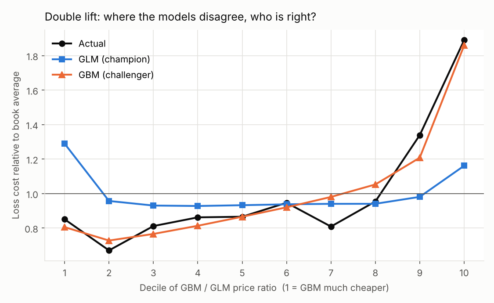
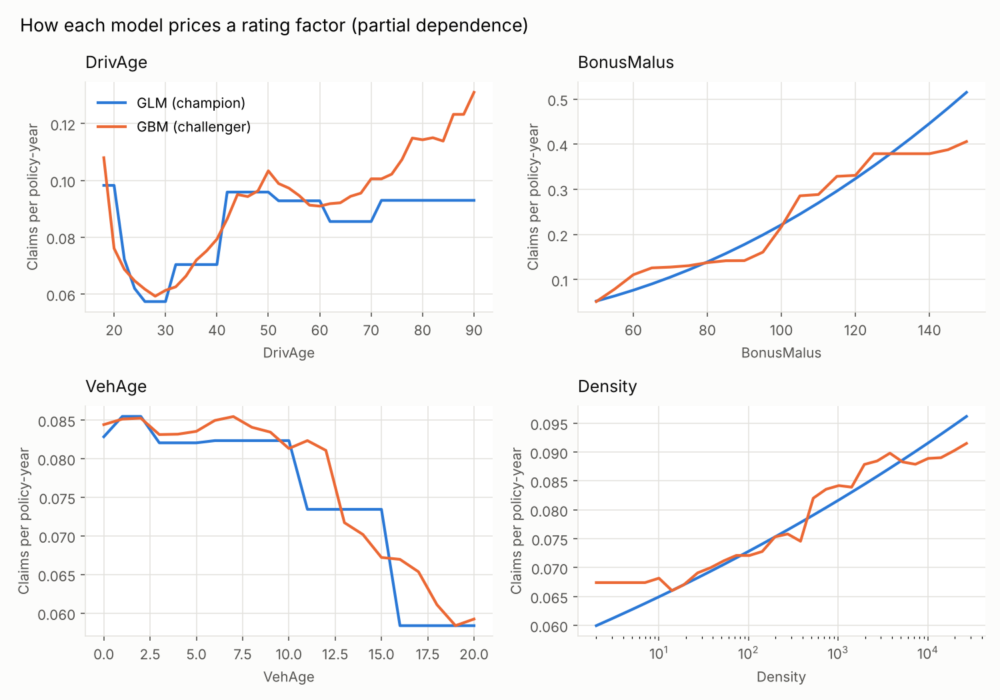
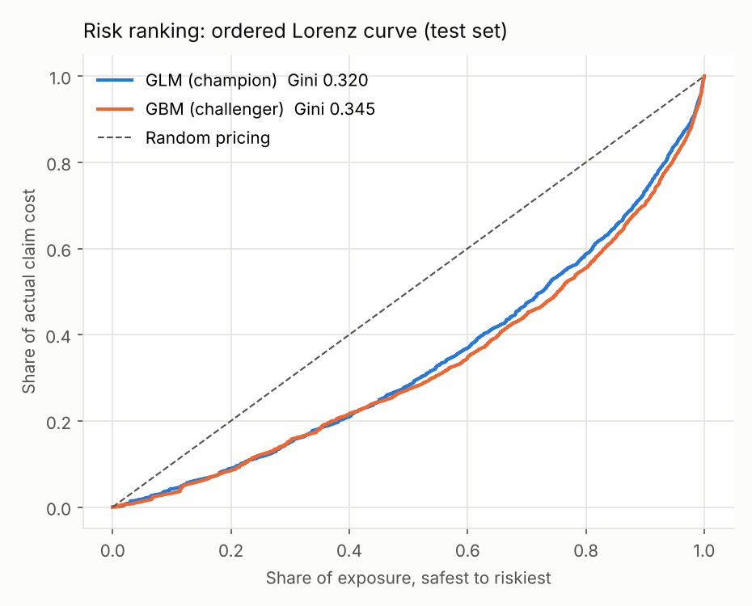
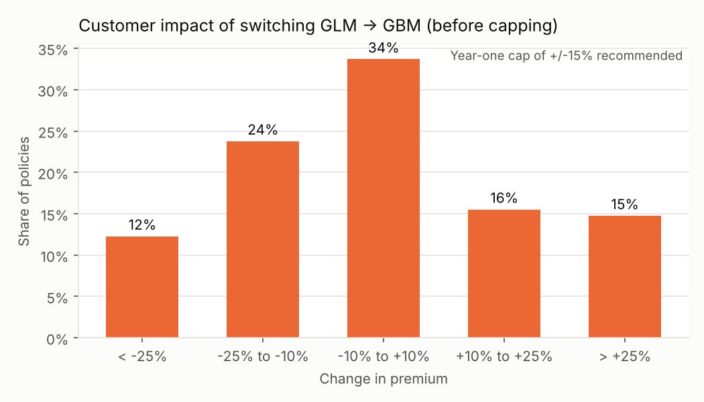
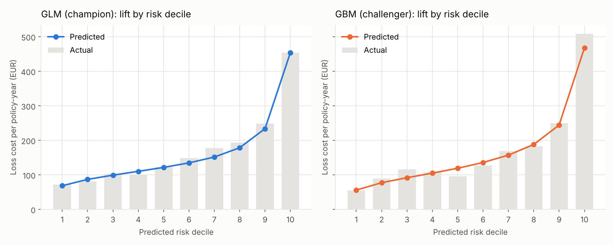
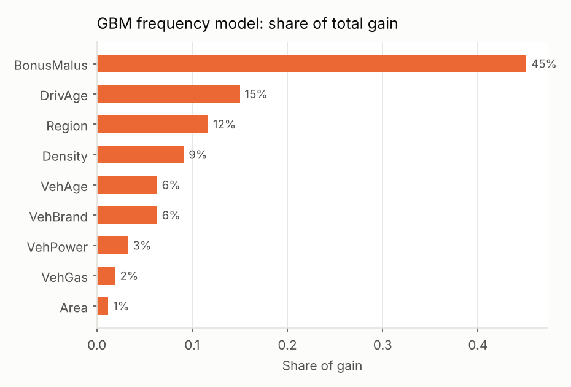

# Auto Insurance Pricing: GLM Champion vs. Gradient-Boosted Challenger

**Should an auto insurer replace its GLM rating plan with a machine-learning model, and if so, how should it roll the change out?**

This project answers that question on 678,000 real motor insurance policies. It builds a frequency–severity pricing model two ways: a GLM, the industry-standard rating plan, and a monotone-constrained LightGBM model. It compares them with the metrics a pricing team uses, then turns the accuracy gap into a business case: loss ratio under competition, customer disruption, and a rate-capped rollout plan. A small quoting tool explains any single price.



*Where the two models disagree, actual claims (black) follow the GBM (orange), not the GLM (blue). In decile 10, the GLM charges ~1.15x the average and the policies actually cost ~1.9x.*

---

## Headline results (held-out test set, 169,565 policies)

| | GLM (champion) | GBM (challenger) |
|---|---|---|
| Gini, pure premium (risk ranking) | 0.320 | **0.345** |
| Poisson deviance, frequency | 0.4559 | **0.4498** |
| Gamma deviance, severity | 1.1820 | 1.1818 |

* **The GBM ranks risk better, and the gain is real.** The Gini improves by +0.026, with a 95% bootstrap interval of +0.014 to +0.037.
* **That gain is worth about 13 to 21 loss-ratio points in a competitive market.** In the simulation, two insurers both target a 70% loss ratio and customers switch for a price at least 5% lower. The GBM insurer writes its book at 73–74%. The GLM insurer is left with the risks it underprices and runs at 87% when it is the incumbent, or 94% when it is the entrant.
* **Shipping the GBM unmodified would disrupt the book.** 27% of existing customers would see their price move by more than 25%.
* **A ±15% year-one rate cap keeps about 60% of the ranking gain**, and the capped plan still writes at a 67% loss ratio against the GLM rival.
* **Most of the signal is in claim frequency. Severity is close to unpredictable from these rating factors**, and both models score about the same on it.
* **Both models underprice drivers under 25 and over 60.** Actual losses are 12–15% above expected (A/E 1.12–1.15) for these groups, which is the first thing I would take to the pricing committee.

Full numbers: [`reports/summary.md`](reports/summary.md). Everything regenerates with `python run_all.py`.

## Recommendation

1. **Adopt GBM-informed pricing with a ±15% year-one cap**, then step toward the uncapped price over later renewals.
2. **Use the GBM as a diagnostic for the filed GLM, too.** The partial-dependence chart below shows exactly where the GLM bands are too coarse: risk rises steadily after age 70, but the GLM prices everyone over 70 at a flat rate. Refining those bands, or adding a driver age × bonus-malus interaction, recovers part of the gain while keeping a transparent, fileable rating table.
3. **Review loadings for young and senior drivers** before either model ships (A/E 1.12–1.15).



## Approach

| Step | What it does | Where |
|---|---|---|
| Data | Downloads the public freMTPL2 tables (policies + individual claims). Claim counts are rebuilt from the claims table because the two published tables disagree for some policies. Exposure is capped at 1 year, and 8 policies with more than 4 claims are dropped as data errors. | `src/data.py` |
| Large losses | Individual claims are capped at the 99.5th percentile (EUR 31k), and the excess comes back as a flat 1.35x load. Both are estimated on training data only. Without this step, a single EUR 1.4M claim in the test set would double one age group's loss ratio. | `src/data.py` |
| GLM champion | Poisson frequency GLM and Gamma severity GLM on actuarial bands: driver age, vehicle age, vehicle power, log bonus-malus, log density, region, brand. | `src/models.py` |
| GBM challenger | LightGBM Poisson model with a log-exposure offset, plus a Gamma severity model. Uses early stopping and a **monotone constraint on bonus-malus**, so a worse claims history can never lower the price. | `src/models.py` |
| Pure premium | Frequency × severity × large-loss load × off-balance factor, so total predicted losses match the training book. | `src/models.py` |
| Evaluation | Deviance, ordered-Lorenz Gini with a bootstrap CI, lift by decile, double lift, and actual-vs-expected by segment. | `src/metrics.py` |
| Explainability | Partial dependence for both models, GBM gain importance, and a filed-style GLM rating table with relativities per level. | `src/explain.py` |
| Business case | Adverse-selection market simulation, customer dislocation analysis, and rate-capping trade-off. | `src/business_case.py` |
| Decision tool | Quotes a policy with both models and lists what drives the price. | `src/quote.py` |

### Quoting tool

```
$ python -m src.quote --driv-age 19 --bonus-malus 90 --veh-age 2 --density 5000 --area E

                               GLM         GBM
frequency                   0.1918      0.1101
severity                 EUR 2,652   EUR 2,318
pure premium               EUR 685     EUR 349
premium                    EUR 979     EUR 498

Proposed year-one premium (GBM, capped at +/-15% vs GLM): EUR 832
```

The GLM stacks the young-driver and high bonus-malus surcharges on top of each other. The GBM has learned that a bonus-malus of 90 is normal for a 19-year-old, because new drivers start above 50. For a 44-year-old, the same score means a poor claims history. Each model sees the data differently, and the tool makes that visible to an underwriter.

### Other charts

| | |
|---|---|
|  |  |
|  |  |

## Run it

**Google Colab (easiest):** open [`walkthrough.ipynb`](walkthrough.ipynb) in Colab and choose *Runtime → Run all*. It takes about 3 minutes, and you don't need an account or an API key.

**Locally (Python 3.10+):**

```bash
pip install -r requirements.txt
python -m tests.smoke_test        # ~30 s on synthetic data, no download
python -m src.data --download     # ~10 MB, public, no login
python -m src.data --inspect
python run_all.py                 # ~90 s; add --sample 0.2 for a quick run
python -m src.quote --driv-age 22 --bonus-malus 80
```

Settings such as the target loss ratio, rate cap, large-loss threshold and model parameters are in [`src/config.py`](src/config.py).

```
├── run_all.py            # end-to-end pipeline
├── walkthrough.ipynb     # executed notebook with all outputs
├── src/
│   ├── config.py         # every setting in one place
│   ├── data.py           # download, cleaning, large-loss capping, synthetic data
│   ├── models.py         # GLM and GBM frequency-severity models
│   ├── metrics.py        # deviance, Gini, lift, double lift, A/E
│   ├── explain.py        # partial dependence, importance, GLM rating table
│   ├── business_case.py  # market simulation, dislocation, rate capping
│   ├── plots.py          # charts
│   ├── report.py         # writes reports/summary.md
│   └── quote.py          # single-policy quoting tool
├── tests/smoke_test.py   # unit checks + full pipeline on synthetic data
└── reports/              # charts, tables, metrics.json, summary.md
```

## Limitations and next steps

* **One policy year, random split.** A production model would be validated out of time on the next year's business. This dataset has no dates.
* **Simple demand model.** The market simulation assumes customers switch at a 5% price gap. A conversion and retention (price-elasticity) model would make the business case sharper.
* **Test-set calibration.** Both models predict about 3.5% below actual (capped) test losses. The off-balance factor is set on training data, and a bootstrap puts one standard error at about 2.6%, so the gap is consistent with sampling noise. In production I would track it with a holdout calibration check each quarter.
* **No telematics.** The natural extension is to add driving-behavior features (mileage, harsh braking, time of day), using the public synthetic telematics dataset of So, Boucher and Valdez (2021).
* **Fairness review.** Before filing, check the rating factors against state regulations and test for proxy effects.
* **Deployment.** Package the scorer as a REST endpoint (Azure ML or a container) and add drift monitoring on input mix and A/E.

## Data

freMTPL2freq and freMTPL2sev, French motor third-party liability portfolio, from the R package [CASdatasets](https://github.com/dutangc/CASdatasets) (Dutang & Charpentier, GPL-2+). It is also mirrored on OpenML (IDs 41214 and 41215). The data is downloaded at run time and is not stored in this repository. Amounts are in euros.

## Author

Dorcas Okaidjah: data scientist and transportation engineer (Ph.D., Iowa State). My day job is modeling traffic safety and crash risk; this project carries that work into how risk is priced. [Portfolio](https://dorcas-okaidjah.github.io/portfolio/)
